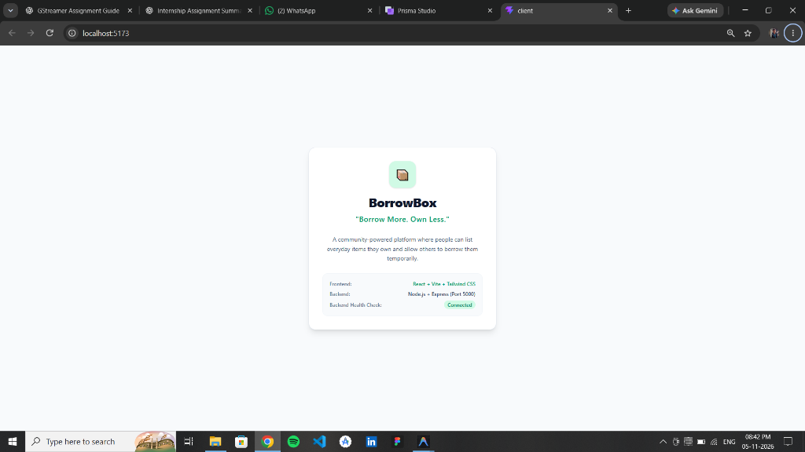
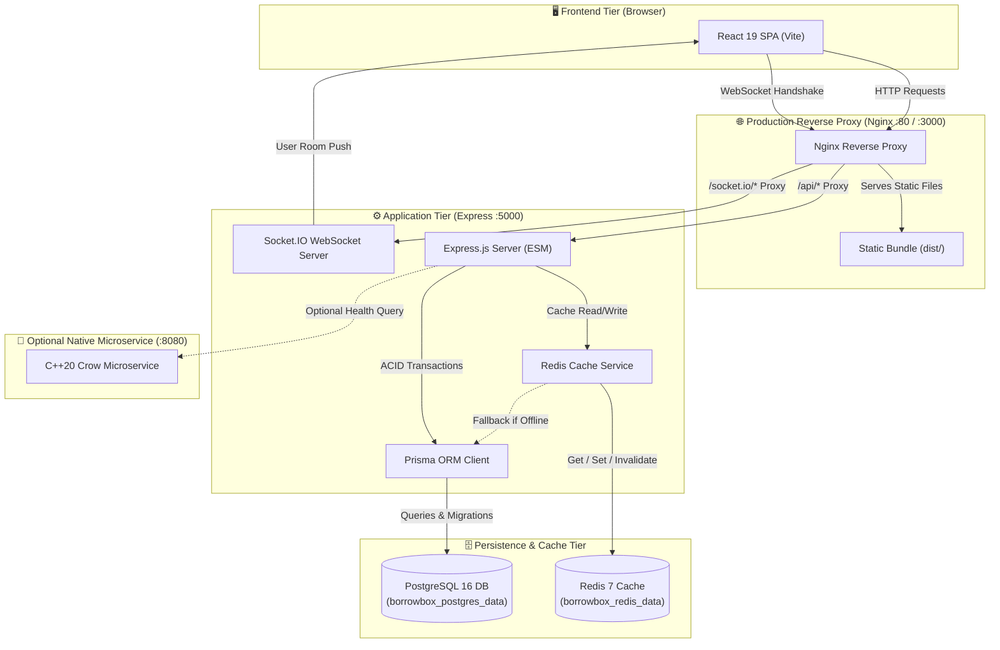
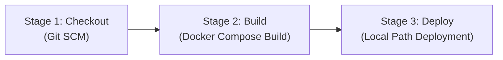

# BorrowBox 📦

> *"Borrow More. Own Less."*

BorrowBox is a community-powered resource borrowing and lending platform where neighbors can list everyday items they own and allow others to borrow them temporarily. Instead of purchasing expensive power tools, camping gear, projectors, or lawn appliances used only once or twice a year, community members share resources sustainably, safely, and economically.

---

> [!IMPORTANT]
> ### ⚡ Quick Start for Evaluators & Reviewers (One-Command Startup)
> Ensure **Docker Desktop** is running, open a terminal in the project root, and execute:
> ```bash
> docker compose up --build
> ```
> 
> - 🌐 **Web Application:** [http://localhost:3000](http://localhost:3000) (Production Nginx SPA)
> - 🔌 **REST API & Gateway:** [http://localhost:5000/api/health](http://localhost:5000/api/health)
> - 👤 **Instant 1-Click Demo Personas:** Click any persona on the `/login` page (*Alice*, *Bob*, *Charlie*, *Dana*) — or login with password `BorrowBox123!`.
> - 🎁 **Optional C++ Crow Microservice:** `docker compose --profile bonus up --build` ➔ [http://localhost:8080/health](http://localhost:8080/health) or [http://localhost:5000/api/crow-health](http://localhost:5000/api/crow-health)
> 
> *The backend container automatically polls PostgreSQL, applies Prisma migrations, and seeds 4 demo personas, 20 catalog items, and active borrow workflows idempotently.*

---

## 📑 Table of Contents

1. [Project Title and Description](#1-project-title-and-description)
2. [Problem Statement and Solution](#2-problem-statement-and-solution)
3. [Main Features](#3-main-features)
4. [Screenshots](#4-screenshots)
5. [Technology Stack](#5-technology-stack)
6. [System Architecture](#6-system-architecture)
7. [Prerequisites](#7-prerequisites)
8. [Installation and Setup](#8-installation-and-setup)
9. [One-Command Docker Execution](#9-one-command-docker-execution)
10. [Application URLs](#10-application-urls)
11. [Demo Login Instructions and Seeded Credentials](#11-demo-login-instructions-and-seeded-credentials)
12. [Step-by-Step Evaluator Guide](#12-step-by-step-evaluator-guide)
13. [Testing Real-Time Notifications (Two Browser Sessions)](#13-testing-real-time-notifications-two-browser-sessions)
14. [API Documentation](#14-api-documentation)
15. [Jenkins CI/CD Pipeline Explanation](#15-jenkins-cicd-pipeline-explanation)
16. [Explanation of Checkout, Build, and Deploy Stages](#16-explanation-of-checkout-build-and-deploy-stages)
17. [Jenkins Setup and Configuration](#17-jenkins-setup-and-configuration)
18. [Troubleshooting](#18-troubleshooting)
19. [Shutdown and Restart Instructions](#19-shutdown-and-restart-instructions)
20. [Project Folder Structure](#20-project-folder-structure)

---

## 1. Project Title and Description

**BorrowBox** is a full-stack, real-time community lending platform engineered with React, Node.js (Express ESM), PostgreSQL, Prisma ORM, Redis caching, and Socket.IO real-time event distribution.

The application allows verified local neighbors to publish items across 8 categories, browse available equipment, request borrowing periods with collision-free scheduling, coordinate handovers via real-time WebSocket notifications, and track item statuses throughout their entire lifecycle.

### 🚀 How to Run (Quick Reviewer Guide)

Ensure **Docker Desktop** is running, then execute in the project root:

```bash
docker compose up --build
```

- 🌐 **Frontend Application:** [http://localhost:3000](http://localhost:3000) (Production Nginx SPA)
- 🔌 **Backend REST API:** [http://localhost:5000/api/health](http://localhost:5000/api/health)
- 👤 **Instant Demo Login:** Navigate to `/login` and click any demo persona card (*Alice*, *Bob*, *Charlie*, *Dana*) to log in with 1 click. Password for manual login: `BorrowBox123!`
- 🎁 **Bonus C++ Crow Service:** `docker compose --profile bonus up --build` (accessible on port 8080)

*(Containers automatically poll PostgreSQL, apply Prisma migrations, and seed sample data idempotently without manual database commands.)*

---

## 2. Problem Statement and Solution

### The Problem
Every year, households spend thousands of dollars purchasing power tools, camping equipment, carpet extractors, pressure washers, and recreational games. Statistical studies show that the average consumer power drill is used for less than 15 minutes across its entire lifespan. The rest of the time, these items occupy valuable storage space in closets and garages. Meanwhile, neighbors living on the same street duplicate these identical purchases, creating unnecessary consumer debt, household clutter, and environmental waste.

### The Solution: BorrowBox
BorrowBox transforms neighborhood communities into cooperative sharing networks:
- **Collision-Free Date Reservations:** A state machine backed by PostgreSQL interactive transactions with collision-check locking guarantees that two borrowers cannot book overlapping dates for the same item (responding with `409 Conflict`).
- **Instant Real-Time Communication:** Real-time push updates via Socket.IO notify owners and borrowers immediately when requests are submitted, approved, handed over, or returned.
- **High-Performance Scalability:** Multi-tiered query caching with Redis ensures instant catalog searching with automated cache invalidation upon any listing change, falling back to PostgreSQL if Redis is offline.
- **Zero-Friction Evaluation:** Pre-seeded demo personas with one-click logins allow evaluators to test all user roles immediately with zero setup.

---

## 3. Main Features

- **🔍 Live Search & Multi-Category Filtering:** Search catalog items by title or description, filter across 8 distinct categories, or narrow listings by neighborhood locality.
- **🛡️ Overlap & Concurrency Prevention:** Concurrency-safe backend validation prevents overlapping approved or active borrow periods, responding with `409 Conflict`.
- **⚡ Real-Time WebSocket Alerts:** Instant Socket.IO notifications for request submissions, status updates, handovers, and returns without client polling.
- **💾 Dual-Tier Caching & Resilient Fallback:** Redis query caching for catalog and detail endpoints with automated cache invalidation. If Redis is unreachable, the system transparently falls back to direct PostgreSQL queries.
- **👥 One-Click Demo Persona Switcher:** Switch between 4 seeded neighbors (Alice, Bob, Charlie, Dana) with one click from the navigation bar or login screen.
- **📊 Activity Management Hub:** Dedicated borrowing and lending tabs displaying full status progressions (`PENDING` ➔ `APPROVED` ➔ `ACTIVE` ➔ `RETURNED`).
- **🔔 Persistent Notification Drawer:** Slide-out drawer with unread counters, relative timestamps, single-item read toggles, and bulk read actions.
- **📱 Responsive Consumer Design:** Custom warm minimalist aesthetic (`#FAF9F5` background, forest green accents, custom cards, dark charcoal typography) optimized for mobile, tablet, and desktop viewports.
- **🎁 Bonus C++ Crow Health Microservice:** Standalone native C++20 microservice using Crow demonstrating high-throughput native services on port 8080.

---

## 4. Screenshots

### Application Launch & Connection Verification


### Community Resource Sharing Hero Preview


*(Additional screenshots of the Explore catalog, Item Details, My Activity dashboard, and Notification Drawer are accessible directly when launching the application.)*

---

## 5. Technology Stack

| Layer | Technology | Version | Purpose |
|---|---|---|---|
| **Frontend** | React SPA | 19.0.0 | Client-side responsive single page application |
| **Bundler** | Vite | 8.x | HMR development server and production bundler |
| **Styling** | Tailwind CSS | v4.x | Utility-first design system with custom warm palette |
| **Icons** | Lucide React | 1.x | Accessible minimalist UI iconography |
| **Web Server** | Nginx | Alpine | Production reverse proxy, static caching, SPA routing |
| **Backend** | Node.js (ESM) | 22.x | Asynchronous REST API and WebSocket gateway |
| **Framework** | Express | 4.21.x | Route handling, authentication middleware, rate limiting |
| **Validation** | Zod | 4.x | Strict schema validation for request payloads and queries |
| **Database** | PostgreSQL | 16.x | Relational ACID database with transaction locking |
| **ORM** | Prisma ORM | 6.19.x | Declarative modeling, schema migrations, and client generation |
| **Caching** | Redis | 7.x | Query cache (`ioredis`) and distributed rate limiter |
| **Real-Time** | Socket.IO | 4.8.x | Authenticated WebSocket user rooms and event delivery |
| **CI/CD** | Jenkins | Declarative | Multi-stage pipeline (Checkout, Build, Deploy) |
| **Containers** | Docker Compose | v2+ | Multi-container orchestration with health dependencies |
| **Bonus** | C++20 Crow | 1.2.x | High-performance native health microservice |

---

## 6. System Architecture



---

## 7. Prerequisites

Before starting, ensure your system meets the following requirements:

### For Docker Execution (Recommended):
- [Docker Desktop](https://www.docker.com/products/docker-desktop/) (v20.10 or higher)
- Docker Compose (v2.0 or higher, bundled with Docker Desktop)
- Git (v2.x or higher)

### For Local Native Execution (Without Docker):
- [Node.js](https://nodejs.org/) (v18.0.0 or higher, tested on v22.14.0)
- [npm](https://www.npmjs.com/) (v9.0.0 or higher, tested on v11.3.0)
- PostgreSQL 16+ running locally on port 5432
- Redis running locally on port 6379 (optional; fallback mode automatically activates if offline)

---

## 8. Installation and Setup

### Step 1: Clone the Repository
```bash
git clone <repository-url>
cd borrowbox
```

### Step 2: Ensure Docker Desktop is Running
- On **Windows / macOS**: Open the Docker Desktop application from your system menu and verify that the engine status icon indicates *"Engine running"*.
- On **Linux**: Verify the Docker daemon status using:
  ```bash
  sudo systemctl status docker
  ```

---

## 9. One-Command Docker Execution

To compile and launch the complete BorrowBox ecosystem (PostgreSQL, Redis, Express Backend, and React Nginx Frontend) in one command:

```bash
docker compose up --build
```

> **Note on Initial Startup:** The first execution may take 2–4 minutes while Docker downloads base images (`node:22-alpine`, `nginx:alpine`, `postgres:16-alpine`, `redis:7-alpine`) and compiles the frontend production bundle. Subsequent startups take only seconds.

### Automated Boot Sequence:
1. **PostgreSQL** starts and passes health checks (`pg_isready`).
2. **Redis** starts and validates ping response.
3. **Backend** container verifies database readiness, deploys Prisma migrations (`npx prisma migrate deploy`), runs the idempotent seed script (`node prisma/seed.js`), and starts Express on port 5000.
4. **Nginx Client** compiles the production bundle, configures reverse-proxy rules for `/api` and `/socket.io`, and serves the application on port 3000 (and port 80).

---

## 10. Application URLs

| Service | URL | Description |
|---|---|---|
| **BorrowBox Web App** | **`http://localhost:3000`** (or `http://localhost`) | Main consumer web application |
| **Backend REST API** | `http://localhost:5000/api` | API root directory |
| **System Health Check** | `http://localhost:5000/api/health` | Comprehensive multi-service health report |
| **Database Health Check**| `http://localhost:5000/api/health/db` | Live PostgreSQL connection & item counts |
| **Nginx Reverse Proxy** | `http://localhost:3000/healthz` | Static proxy health status |
| **Bonus C++ Crow** | `http://localhost:8080/health` | Standalone C++ health endpoint |

---

## 11. Demo Login Instructions and Seeded Credentials

The database is pre-seeded with **4 neighborhood personas** and **20 realistic catalog items**. All demo accounts share the password: `BorrowBox123!` (or can be accessed via **1-click login** on the login screen):

| Persona Name | Email | Password | Locality | Pre-Seeded Inventory & Role |
|---|---|---|---|---|
| **Alice Green** | `alice@borrowbox.local` | `BorrowBox123!` | Oakwood Neighborhood | Owns *Inflatable Kayak*, *Lawn Aerator*, *Power Drill*, *YETI Cooler*. Has an approved tent trip with Bob. |
| **Bob Builder** | `bob@borrowbox.local` | `BorrowBox123!` | Maple Heights | Owns *Coleman Tent*, *Telescopic Ladder*, *Bike Rack*. Currently has an active loan of Charlie's *Pressure Washer*! |
| **Charlie Rivers** | `charlie@borrowbox.local` | `BorrowBox123!` | Pinecrest District | Owns *Kärcher Pressure Washer* (on active loan), *Projector*, *Reel Mower*, *Tool Kit*. |
| **Dana Hayes** | `dana@borrowbox.local` | `BorrowBox123!` | Sunnyvale Commons | Owns *Circular Saw*, *String Trimmer*, *Lawn Jenga*, *Travel Atlas*. Has a pending request for Bob's ladder. |

### How to Log In:
1. Navigate to `http://localhost:3000/login`.
2. Under the **"Demo Accounts"** tab, click on any persona card (e.g., **"Alice Green"**).
3. The session initializes immediately without typing passwords.
4. To switch personas, click the user profile pill in the top-right corner of the navigation bar and select another persona.

---

## 12. Step-by-Step Evaluator Guide

Follow these 4 self-contained test scenarios to verify all core functional requirements:

### Test 1: Explore Catalog, Search & Filter
1. Open `http://localhost:3000`.
2. Type `"drill"` into the search bar ➔ Observe instant filtering displaying the *Bosch 18V Cordless Power Drill*.
3. Click the **"Outdoors & Camping"** category pill ➔ Notice the catalog updates to display the *Coleman Camping Tent*, *YETI Cooler*, and *Camp Chef Stove*.

### Test 2: Double-Booking Overlap Prevention (409 Conflict)
1. In the pre-seeded database, Bob's *Coleman Sundome 4-Person Camping Tent* is already `APPROVED` for Alice for upcoming dates.
2. Sign in as **Dana Hayes** (via 1-click login).
3. Find the *Coleman Sundome 4-Person Camping Tent* on the Explore page and click **"Request to Borrow"**.
4. Select dates that overlap with Alice's reservation.
5. **Observed Result:** The server immediately rejects the request with HTTP `409 Conflict`, displaying a message informing the user that the item is already booked for those dates.

### Test 3: Complete State Machine Progression
1. Sign in as **Bob Builder** and navigate to **My Activity** ➔ **Lending Tab**.
2. Locate the incoming `PENDING` request from Dana for the *12.5ft Extension Ladder*.
3. Click **"Approve Request"** ➔ Status transitions to `APPROVED`.
4. Click **"Mark as Picked Up / Active"** ➔ Status transitions to `ACTIVE`, and item availability flips to `BORROWED`.
5. Click **"Confirm Item Returned"** ➔ Status transitions to `RETURNED`, and the item returns to `AVAILABLE`.

### Test 4: Redis Caching and Observable Invalidation
1. Open terminal logs:
   ```bash
   docker compose logs -f server
   ```
2. In your browser, switch between category filters (`Tools`, `Gardening`, `Camping`).
3. Notice structured cache logs in the console:
   ```text
   💾 [Redis Cache] SET: "items:list:cat=TOOLS:..." (TTL: 300s)
   ⚡ [Redis Cache] HIT: "items:list:cat=TOOLS:..."
   ```
4. Create or edit an item ➔ Observe immediate pattern invalidation:
   ```text
   🧹 [Redis Cache] INVALIDATED PATTERN: "items:list:*"
   ```

---

## 13. Testing Real-Time Notifications (Two Browser Sessions)

This workflow verifies the WebSocket real-time event pipeline using two concurrent browser sessions:

1. **Window 1 (Standard Browser):**
   - Navigate to `http://localhost:3000/login` and log in as **Bob Builder**.
2. **Window 2 (Incognito / Private Window):**
   - Navigate to `http://localhost:3000/login` and log in as **Alice Green**.
3. **In Window 1 (Bob):**
   - Go to **Explore** and select Alice's *Heavy-Duty Manual Lawn Aerator*.
   - Pick dates 10–14 days in the future and click **"Request to Borrow"**.
4. **Observe Window 2 (Alice):**
   - Without refreshing the page, the notification bell badge increments, a floating toast alert appears, and the new request appears in the notification drawer.
5. **In Window 2 (Alice):**
   - Open **My Activity** and approve the request.
6. **Observe Window 1 (Bob):**
   - Bob's outgoing request status updates to `APPROVED` in real time with an instant push alert.

---

## 14. API Documentation

Complete REST API specifications, request/response payloads, Zod validation schemas, error formats, and Socket.IO event contracts are documented in:

👉 **[docs/API.md](docs/API.md)**

---

## 15. Jenkins CI/CD Pipeline Explanation

BorrowBox includes a declarative [`Jenkinsfile`](Jenkinsfile) located at the repository root. The pipeline automates continuous integration and local deployment on the machine running Jenkins.



### Key Principles:
- **Declarative Pipeline:** Structured using standard declarative Jenkins syntax (`pipeline { agent any ... }`) with strict stage isolation.
- **Configurable Deployment Path:** Uses the `PREDEFINED_DEPLOY_PATH` environment variable. Evaluators or deployment engineers configure this parameter in Jenkins to target any predefined directory.
  > [!NOTE]
  > The pipeline default (`/opt/borrowbox` on Linux or `${WORKSPACE}/deploy` on Windows) is a local fallback placeholder for independent testing, **not** an official company-mandated directory. The deployment target must be configured via `PREDEFINED_DEPLOY_PATH` once specified by the evaluator.
- **Avoid Unnecessary Rebuilds:** Images are compiled once during Stage 2 (`docker compose build`). Stage 3 (`Deploy`) executes `docker compose up -d` with the pre-built images without redundant `--build` flags.
- **Safe File Copying:** Synchronizes essential runtime definitions (`docker-compose.yml`, `server`, `client`, `bonus`, Prisma migrations & seed) while strictly excluding secrets (`.env`), `node_modules`, `.git`, and local build artifacts (`dist`, `build`). Copy failures are treated as fatal errors.
- **Data Volume Preservation:** Gracefully restarts services using `docker compose down --remove-orphans` without the `-v` flag, ensuring the PostgreSQL named volume (`borrowbox_postgres_data`) and Redis volume (`borrowbox_redis_data`) remain intact across redeployments.
- **Active Health Verification:** Instead of assuming success from `docker compose ps`, the pipeline executes an active 120-second polling loop inspecting the live health status (`docker inspect`) of `borrowbox-postgres`, `borrowbox-redis`, `borrowbox-server`, and `borrowbox-client`. If any container is unhealthy or times out, the pipeline fails and dumps diagnostic container logs.

---

## 16. Explanation of Checkout, Build, and Deploy Stages

### Stage 1: Checkout
- **Purpose:** Retrieves the latest revision of the codebase from the Git repository.
- **Implementation:** Executes `checkout scm` using Jenkins' native SCM step.
- **Telemetry:** Resolves and outputs the checked-out commit SHA (`git rev-parse --short HEAD`) to the pipeline build log.

### Stage 2: Build
- **Purpose:** Verifies Docker engine / CLI availability and builds production container images.
- **Implementation:** Executes `docker compose build` to compile the multi-stage frontend Nginx container and backend Node.js container with Prisma bindings.

### Stage 3: Deploy
- **Purpose:** Deploys the containerized application locally to the configured predefined path.
- **Implementation:**
  1. **Directory Creation:** Ensures the destination directory exists (`mkdir -p "${DEPLOY_DIR}"`).
  2. **Safe File Transfer:**
     - *Linux / macOS:* Streams required directories via `tar` with explicit exclusion flags (`--exclude='node_modules' --exclude='.env*' --exclude='.git' --exclude='dist' --exclude='build'`).
     - *Windows:* Uses Windows native `robocopy` with `/XD node_modules .git dist` and `/XF .env .env.*`, checking error levels (`if !ERRORLEVEL! GEQ 8 exit /b 1`).
  3. **Zero-Data-Loss Shutdown:** Executes `docker compose down --remove-orphans` in the target directory (volumes preserved).
  4. **Container Launch:** Starts all services in detached mode with pre-built images (`docker compose up -d`).
  5. **120-Second Health Polling Loop:**
     - Polls `docker inspect --format '{{.State.Health.Status}}'` every 5 seconds for `borrowbox-postgres`, `borrowbox-redis`, `borrowbox-server`, and `borrowbox-client`.
     - Confirms that all services reach `healthy` status.
     - If the timeout expires or a service enters an unhealthy state, the pipeline immediately halts with exit code 1 and outputs container status and recent diagnostics logs (`docker logs --tail 50`).

---

## 17. Jenkins Setup and Configuration

Follow these step-by-step instructions to run the pipeline locally or on a CI/CD server:

### Option A: Running Jenkins Locally via Docker (Beginner-Friendly)

If Jenkins is not already installed on your machine, launch an official Jenkins LTS container with Docker socket access:

1. **Start Jenkins Container:**
   - *Linux / macOS:*
     ```bash
     docker run -d \
       --name jenkins-borrowbox \
       -p 8080:8080 \
       -p 50000:50000 \
       -v jenkins_home:/var/jenkins_home \
       -v /var/run/docker.sock:/var/run/docker.sock \
       jenkins/jenkins:lts
     ```
   - *Windows (Docker Desktop):*
     ```powershell
     docker run -d `
       --name jenkins-borrowbox `
       -p 8080:8080 `
       -p 50000:50000 `
       -v jenkins_home:/var/jenkins_home `
       -v //var/run/docker.sock:/var/run/docker.sock `
       jenkins/jenkins:lts
     ```

2. **Retrieve Initial Admin Password:**
   ```bash
   docker exec jenkins-borrowbox cat /var/jenkins_home/secrets/initialAdminPassword
   ```

3. **Complete Initial Setup:**
   - Open [http://localhost:8080](http://localhost:8080) in your browser.
   - Paste the admin password and select **"Install suggested plugins"**.
   - Create your administrator account.

4. **Ensure Docker CLI is Available inside the Jenkins Container:**
   ```bash
   docker exec -u 0 jenkins-borrowbox apt-get update
   docker exec -u 0 jenkins-borrowbox apt-get install -y docker.io docker-compose-v2
   docker exec -u 0 jenkins-borrowbox usermod -aG docker jenkins
   docker restart jenkins-borrowbox
   ```

---

### Option B: Creating the Pipeline Job in Jenkins

1. **Create New Item:**
   - On the Jenkins dashboard, click **"New Item"**.
   - Enter `borrowbox-pipeline`, select **"Pipeline"**, and click **OK**.

2. **Configure General & Parameters:**
   - Check **"This project is parameterized"**.
   - Click **"Add Parameter"** ➔ select **"String Parameter"**.
     - **Name:** `PREDEFINED_DEPLOY_PATH`
     - **Default Value:** `/opt/borrowbox` (or your local directory, e.g. `./deploy`)
     - **Description:** Predefined local deployment directory for BorrowBox container deployment.

3. **Configure Pipeline Script from SCM:**
   - Scroll down to the **Pipeline** section.
   - **Definition:** Select `Pipeline script from SCM`.
   - **SCM:** Select `Git`.
   - **Repository URL:** Enter your GitHub repository URL (e.g. `https://github.com/your-username/borrowbox.git`).
   - **Credentials:** Add your GitHub personal access token (PAT) or SSH key if the repository is private.
   - **Branch Specifier:** `*/master` (or `*/main`).
   - **Script Path:** `Jenkinsfile`.

4. **Execute and Inspect the Pipeline:**
   - Click **"Save"**.
   - Click **"Build with Parameters"** (verify or adjust `PREDEFINED_DEPLOY_PATH`) ➔ click **"Build"**.
   - Inspect the build in real-time under **Stage View** or click on the build number ➔ **"Console Output"** to view Checkout, Build, and Deploy execution logs.

---

## 18. Troubleshooting

### 1. Docker Desktop Not Running
- **Symptom:** `Cannot connect to the Docker daemon` or `docker: command not found`.
- **Solution:** Open Docker Desktop from your operating system applications menu. Wait until the whale icon in the taskbar becomes steady.

### 2. Port 3000, 5000, or 5432 Already Occupied
- **Symptom:** `Bind for 0.0.0.0:3000 failed: port is already allocated`.
- **Solution:** Identify and terminate the occupying process:
  - *Windows PowerShell:*
    ```powershell
    Get-NetTCPConnection -LocalPort 3000, 5000, 5432 -ErrorAction SilentlyContinue | Stop-Process -Id { $_.OwningProcess }
    ```
  - *Linux / macOS:*
    ```bash
    lsof -ti :3000,:5000,:5432 | xargs kill -9
    ```

### 3. Docker Image Download or Network Failures
- **Symptom:** `error pulling image configuration: download failed`.
- **Solution:** Check your internet connection. Retry pulling base images manually:
  ```bash
  docker pull node:22-alpine
  docker pull postgres:16-alpine
  docker pull redis:7-alpine
  docker pull nginx:alpine
  ```

### 4. Database Connection Failures
- **Symptom:** Backend logs indicate `P1001: Can't reach database server`.
- **Solution:** Verify that the `postgres` container is healthy:
  ```bash
  docker compose ps postgres
  docker compose logs postgres
  ```

### 5. Prisma Migration or Seed Errors
- **Symptom:** `PrismaClientKnownRequestError` during startup.
- **Solution:** Re-run the idempotent seed script manually:
  ```bash
  docker compose exec server node prisma/seed.js
  ```

### 6. Frontend Failing to Connect to the Backend
- **Symptom:** Network error banners in the web browser.
- **Solution:** Check that the backend container is healthy at `http://localhost:5000/api/health`. In Docker, Nginx automatically proxies `/api/` to `http://server:5000/api/`.

### 7. Jenkins Not Detecting Docker
- **Symptom:** `docker: Permission denied` inside Jenkins build console.
- **Solution:** Add the Jenkins user to the Docker group:
  ```bash
  sudo usermod -aG docker jenkins
  sudo systemctl restart jenkins
  ```

### 8. Socket.IO Connection Issues
- **Symptom:** Real-time indicator displays *"Offline"* or *"Connecting..."*.
- **Solution:** Confirm that Nginx is proxying `/socket.io/` with WebSocket upgrade headers. Ensure your browser is not blocking WebSockets through a restrictive proxy extension.

---

## 19. Shutdown and Restart Instructions

### Stop Containers (Preserving Database Volume):
```bash
docker compose down
```

### Restart Containers:
```bash
docker compose up -d
```

### Complete Factory Reset (Wiping Database Volume):
```bash
# Stops containers and removes persistent volumes for a fresh seed start
docker compose down -v
docker compose up --build
```

---

## 20. Project Folder Structure

```text
BorrowBox/
├── .dockerignore                         # Global Docker build exclusions
├── .env.example                          # Root environment variable template
├── .gitignore                            # Git file exclusions
├── docker-compose.yml                    # Multi-container production orchestration
├── Jenkinsfile                           # Declarative CI/CD pipeline (Checkout, Build, Deploy)
├── package.json                          # Root monorepo scripts & orchestrator
├── README.md                             # Comprehensive project documentation
│
├── bonus/                                # Optional bonus components
│   └── crow-service/                     # C++20 Crow HTTP health microservice
│       ├── CMakeLists.txt                # CMake build configuration
│       ├── Dockerfile                    # Multi-stage Alpine C++ container definition
│       ├── main.cpp                      # Microservice source code (:8080)
│       └── README.md                     # Microservice instructions
│
├── client/                               # Frontend single-page application (React 19 + Vite)
│   ├── .dockerignore                     # Frontend Docker exclusions
│   ├── .env.example                      # Client environment template
│   ├── Dockerfile                        # Multi-stage build (Node builder -> Nginx runner)
│   ├── nginx.conf                        # Production Nginx reverse-proxy & WebSocket config
│   ├── package.json                      # Client dependencies & scripts
│   ├── vite.config.js                    # Vite bundler & development proxy config
│   └── src/
│       ├── api/                          # REST API clients (auth, items, borrow, notifications)
│       ├── components/                   # UI components (common, layout, notifications)
│       ├── context/                      # React Context providers (Auth, Socket, Toast)
│       ├── pages/                        # Page views (Explore, ItemDetail, ListItem, Activity, Login)
│       ├── utils/                        # Formatters, category metadata, fallback images
│       ├── App.jsx                       # Routing & application shell
│       ├── index.css                     # Global Tailwind CSS imports
│       └── main.jsx                      # Client entry point
│
├── docs/                                 # Documentation assets
│   ├── API.md                            # Comprehensive REST & Socket.IO API specifications
│   └── screenshots/                      # Verification screenshots & previews
│
└── server/                               # Backend application (Node.js ESM Express)
    ├── .dockerignore                     # Backend Docker exclusions
    ├── .env.example                      # Server environment template
    ├── Dockerfile                        # Backend container definition
    ├── docker-entrypoint.sh              # Preflight database readiness & seed script
    ├── package.json                      # Server dependencies & scripts
    ├── prisma/
    │   ├── migrations/                   # PostgreSQL schema migrations
    │   ├── schema.prisma                 # Declarative Prisma database schema
    │   └── seed.js                       # Idempotent seed script (4 personas, 20 items, requests)
    ├── src/
    │   ├── config/                       # Environment configuration
    │   ├── controllers/                  # Route controller handlers
    │   ├── errors/                       # Centralized AppError classes
    │   ├── middleware/                   # JWT auth, validation, rate limiter, error handler
    │   ├── redis/                        # Redis client & caching service
    │   ├── routes/                       # Express router modules
    │   ├── schemas/                      # Zod request validation schemas
    │   ├── services/                     # Business logic (auth, items, borrowing, notifications)
    │   ├── socket/                       # Socket.IO WebSocket gateway & user rooms
    │   ├── db.js                         # Prisma connection singleton
    │   └── index.js                      # Express application entry point (:5000)
    ├── test-step3a.js                    # 47-assertion core backend test suite
    └── test-step4.js                     # 31-assertion Redis & Socket.IO test suite
```

---

## 📄 License & Integrity

Developed for the BorrowBox full-stack engineering challenge. All source code, database migrations, caching mechanisms, WebSocket handlers, and container configurations strictly adhere to production engineering standards.
