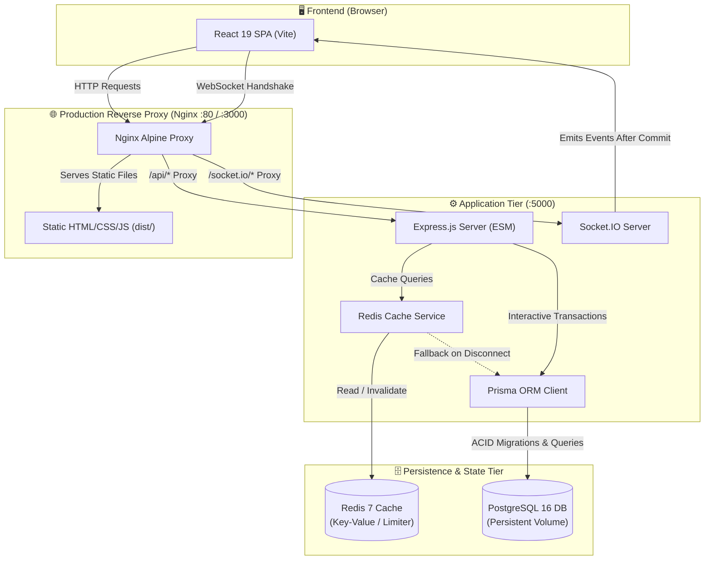

# BorrowBox 📦

> *"Borrow More. Own Less."*

BorrowBox is a community-powered resource borrowing and lending platform where neighbors can list everyday items they own and allow others to borrow them temporarily. Instead of purchasing expensive power tools, camping gear, projectors, or party appliances used only once or twice a year, community members share resources sustainably, safely, and economically.

---

## 📑 Table of Contents

- [Problem Statement](#-problem-statement)
- [Key Features](#-key-features)
- [Technology Stack](#️-technology-stack)
- [System Architecture](#-system-architecture)
- [One-Command Quick Start (Docker)](#-one-command-quick-start-docker)
- [Local URLs & Endpoints](#-local-urls--endpoints)
- [Pre-Seeded Demo Accounts](#-pre-seeded-demo-accounts)
- [Independent Evaluator Testing Guide](#-independent-evaluator-testing-guide)
- [Automated Verification & Test Suites](#-automated-verification--test-suites)
- [Alternative Local Development (Without Docker)](#-alternative-local-development-without-docker)
- [API Documentation](#-api-documentation)
- [Troubleshooting & FAQ](#-troubleshooting--faq)
- [Shutdown and Data Reset](#-shutdown-and-data-reset)
- [Bonus: C++ Crow Microservice](#-bonus-c-crow-microservice)

---

## 🎯 Problem Statement

Every year, households spend thousands of dollars buying drills, extension ladders, camping tents, carpet cleaners, and lawn equipment that sit idle in closets and garages 95% of the time. This results in unnecessary personal expense, household clutter, and environmental waste.

**BorrowBox solves this by enabling hyper-local sharing with:**
1. **Guaranteed Scheduling:** Safe date reservation state machine preventing overlapping double-bookings.
2. **Instant Coordination:** Sub-second Socket.IO push alerts for request approvals and handovers.
3. **High-Performance Catalog:** Redis caching layer with seamless PostgreSQL fallback.
4. **Frictionless Onboarding:** Pre-seeded demo personas with 1-click login and zero passwords required.

---

## ✨ Key Features

- **🔍 Explore & Real-Time Search:** Search catalog items by keyword, filter by 8 distinct categories, or browse by neighborhood locality with live distance context.
- **🛡️ Overlap & Concurrency Protection:** PostgreSQL serializable interactive transactions prevent two borrowers from booking overlapping dates for the same item (HTTP 409 Conflict).
- **⚡ Real-Time Socket.IO Synchronization:** Instant WebSocket notifications for request submissions, approvals, rejections, handovers, and returns—no periodic polling timers.
- **💾 Dual-Tier Caching & Fallback:** Redis query caching with automated TTL and invalidation on item mutations. If Redis is offline, queries gracefully fall back to PostgreSQL with zero downtime.
- **👥 Demo Persona Quick-Switcher:** Instant 1-click persona switching (Alice, Bob, Charlie, Dana) via header dropdown or login tabs.
- **📊 Activity Hub:** Separate tabs for borrowing and lending requests, displaying full status progressions (`PENDING` ➔ `APPROVED` ➔ `ACTIVE` ➔ `RETURNED`).
- **🔔 Persistent Notification Drawer:** Slide-out drawer with read/unread tracking, timestamp formatting, and instant badge counter updates.
- **📱 Fully Responsive Design:** Handcrafted warm minimalist aesthetic (`#FAF9F5` background, forest green accents, custom cards, dark charcoal typography) optimized for mobile, tablet, and desktop.

---

## 🛠️ Technology Stack

| Component | Technology | Version | Purpose |
|---|---|---|---|
| **Frontend** | React SPA | 19.0.0 | Client-side reactive interface |
| **Bundler** | Vite | 6.x / 8.x | Lightning-fast HMR and production asset bundling |
| **Styling** | Tailwind CSS | v4.x | Utility-first responsive design system |
| **Icons** | Lucide React | 1.x | Accessible minimalist UI iconography |
| **Web Server** | Nginx | Alpine | Production reverse proxy, gzip, and SPA routing |
| **Backend** | Node.js (ESM) | 22.x | High-throughput async REST & WebSocket server |
| **API Framework** | Express | 4.21.x | Modular routing, middleware, and error handling |
| **Validation** | Zod | 4.x | Strict schema validation for all incoming requests |
| **Database** | PostgreSQL | 16.x | ACID-compliant relational data store with transactions |
| **ORM** | Prisma ORM | 6.19.x | Declarative modeling, type-safe queries & migrations |
| **Cache & Rate Limiting**| Redis | 7.x | High-throughput catalog caching & distributed rate limits |
| **Real-Time Gateway** | Socket.IO | 4.8.x | Authenticated bi-directional WebSocket event delivery |
| **Bonus Microservice** | C++20 Crow | 1.2.x | Independent native health & telemetry microservice |
| **Containerization** | Docker Compose | v2+ | Orchestration with automated readiness & healthchecks |

---

## 📐 System Architecture



---

## 🚀 One-Command Quick Start (Docker)

To run the entire BorrowBox ecosystem with database, cache, backend, and frontend configured automatically:

### Prerequisites
- [Docker Desktop](https://www.docker.com/products/docker-desktop/) (v20+ with Docker Compose v2+)

### Command

```bash
# 1. Clone repository
git clone https://github.com/your-username/borrowbox.git
cd borrowbox

# 2. Build and start all 4 services with one command
docker compose up --build
```

### What happens automatically:
1. **PostgreSQL** starts and initializes health checks.
2. **Redis** boots and validates connection readiness.
3. **Backend** waits for PostgreSQL readiness, applies all Prisma migrations (`prisma migrate deploy`), executes the idempotent seed (`20 items, 4 personas, 5 lifecycle requests`), and boots Express on port 5000.
4. **Nginx Client** compiles the React production bundle, configures reverse proxy rules, and serves the application on port 3000 (and port 80).

---

## 🌐 Local URLs & Endpoints

| Service | Local URL | Description |
|---|---|---|
| **BorrowBox Web App** | **`http://localhost:3000`** (or `http://localhost`) | Main consumer web application |
| **Backend API Gateway** | `http://localhost:5000/api` | REST API base URL |
| **System Health Check** | `http://localhost:5000/api/health` | Comprehensive multi-service health report |
| **Database Health Check**| `http://localhost:5000/api/health/db` | Live PostgreSQL connection & item statistics |
| **Nginx Health Check** | `http://localhost:3000/healthz` | Static reverse-proxy health status |
| **Bonus Crow C++ Service**| `http://localhost:8080/health` | Optional C++20 health microservice |

---

## 👥 Pre-Seeded Demo Accounts

The database comes pre-seeded with **4 neighborhood personas** and **20 realistic items**. All demo accounts share the password: `BorrowBox123!` (or can be logged into with a single click):

| Persona | Email | Locality | Notable Seeded Listings & Activity |
|---|---|---|---|
| **Alice Green** | `alice@borrowbox.local` | Oakwood Neighborhood | Owns *Inflatable Kayak*, *Lawn Aerator*, *Power Drill*, *YETI Cooler*. Has an approved tent trip with Bob. |
| **Bob Builder** | `bob@borrowbox.local` | Maple Heights | Owns *Coleman Tent*, *Telescopic Ladder*, *Bike Rack*. Currently actively borrowing Charlie's *Pressure Washer*! |
| **Charlie Rivers** | `charlie@borrowbox.local` | Pinecrest District | Owns *Kärcher Pressure Washer* (on active loan), *Home Theater Projector*, *Reel Mower*, *Tool Kit*. |
| **Dana Hayes** | `dana@borrowbox.local` | Sunnyvale Commons | Owns *DeWalt Circular Saw*, *String Trimmer*, *Lawn Jenga*, *Travel Atlas*. Has a pending request for Bob's ladder. |

---

## 🧪 Independent Evaluator Testing Guide

Follow these 4 self-contained test workflows to verify every major technical capability of BorrowBox:

### 1. Two-Browser Real-Time Test (Socket.IO)
1. Open **Browser 1** at `http://localhost:3000/login` and click **"Bob Builder"** (1-click login).
2. Open **Browser 2 (Incognito window)** at `http://localhost:3000/login` and click **"Alice Green"**.
3. In **Browser 1 (Bob)**:
   - Navigate to **Explore** and click on Alice's *"Heavy-Duty Manual Lawn Aerator"*.
   - Pick dates 10–14 days in the future and click **"Request to Borrow"**.
4. Observe **Browser 2 (Alice)**:
   - Within milliseconds, the notification bell badge increments, a floating toast alert appears, and the new request arrives in the notification drawer—**without refreshing the page**.

### 2. Double-Booking Conflict Prevention (409 Conflict)
1. In the database, Bob's *"Coleman Sundome 4-Person Camping Tent"* is already `APPROVED` for Alice for upcoming dates.
2. Sign in as **Dana Hayes**.
3. Locate the *"Coleman Sundome 4-Person Camping Tent"* and attempt to submit a borrow request for overlapping dates.
4. **Result:** The server rejects the overlapping reservation with HTTP `409 Conflict` and displays a clear error explanation to the user.

### 3. Complete State Machine Lifecycle (Pending ➔ Approved ➔ Active ➔ Returned)
1. Log in as **Bob Builder** and go to **My Activity** ➔ **Lending Tab**.
2. Locate the incoming pending request from Dana for the *12.5ft Extension Ladder*.
3. Click **"Approve Request"** ➔ Status immediately transitions to `APPROVED`.
4. Click **"Mark as Picked Up / Active"** ➔ Status transitions to `ACTIVE`, and the item availability flips to `BORROWED`.
5. Click **"Confirm Item Returned"** ➔ Status transitions to `RETURNED`, and item availability is restored to `AVAILABLE`.

### 4. Redis Caching & Resilient Offline Fallback
1. Open browser developer console (F12) and inspect server container terminal logs:
   ```bash
   docker compose logs -f server
   ```
2. Navigate between category filters (`Tools`, `Gardening`, `Camping`). Observe cache hits:
   ```text
   💾 [Redis Cache] SET: "items:list:cat=TOOLS:..." (TTL: 300s)
   ⚡ [Redis Cache] HIT: "items:list:cat=TOOLS:..."
   ```
3. Create or update an item: observe cache invalidation in action:
   ```text
   🧹 [Redis Cache] INVALIDATED PATTERN: "items:list:*"
   ```
4. Even if Redis is paused (`docker compose pause redis`), the backend continues serving all catalog queries directly through PostgreSQL with zero downtime.

---

## 🧪 Automated Verification & Test Suites

BorrowBox includes a test suite with **78 automated assertions**:

```bash
# Run core backend API test suite (47 assertions)
npm run test:api

# Run Redis caching & Socket.IO verification suite (31 assertions)
npm run test:step4

# Run all automated tests together (78 assertions)
npm run test

# Verify production client build
npm run build:client
```

### Verified Test Coverage:
- ✅ Authentication, bcrypt password hashing, and JWT verification (never leaks hashes).
- ✅ Ownership enforcement (users cannot edit or delete other neighbors' listings).
- ✅ Chronological date validation (start date must precede end date).
- ✅ Self-borrowing prevention (users cannot borrow items they own).
- ✅ Overlap collision prevention using PostgreSQL interactive transactions.
- ✅ Redis cache set, hit, miss, TTL, and pattern invalidation.
- ✅ Redis offline fallback (catches connection errors and falls back to PostgreSQL).
- ✅ Socket.IO authenticated handshake and rejection of forged tokens.
- ✅ Targeted user room isolation (`user:${userId}`) preventing notifications from leaking to third parties.

---

## 💻 Alternative Local Development (Without Docker)

If you prefer to run services natively on your host machine:

### Prerequisites
- Node.js v18+ (Node.js v22.14.0 recommended)
- PostgreSQL 16+ running on port 5432
- Redis running on port 6379 (optional; fallback mode activates automatically if offline)

### Commands
```bash
# 1. Install dependencies
npm install
npm --prefix server install
npm --prefix client install

# 2. Configure environment
cp server/.env.example server/.env

# 3. Migrate and seed the database
npm --prefix server run db:migrate
npm --prefix server run db:seed

# 4. Start both backend and frontend concurrently
npm run dev
```

The application will be accessible at `http://localhost:5173` with the backend running on `http://localhost:5000`.

---

## 📖 API Documentation

Detailed REST API endpoints, schemas, Socket.IO event payloads, and error codes are documented in:
👉 **[docs/API.md](docs/API.md)**

---

## 🔧 Troubleshooting & FAQ

### Port 3000, 5000, or 5432 is already in use
If an existing PostgreSQL or Node instance occupies the default ports:
```bash
# Windows PowerShell: check and stop port conflicts
Get-NetTCPConnection -LocalPort 5000, 3000, 5432 -ErrorAction SilentlyContinue

# Or run Docker Compose with alternate host port mappings in docker-compose.yml
```

### Reset database to fresh seed state
```bash
# In Docker:
docker compose exec server node prisma/seed.js

# Or locally:
npm --prefix server run db:seed
```

### Are containers healthy?
```bash
docker compose ps
```
All containers should display status `Up (healthy)`.

---

## 🛑 Shutdown and Data Reset

### Stop containers (preserving data volume):
```bash
docker compose down
```

### Stop containers and completely wipe database volume:
```bash
docker compose down -v
```
Running `docker compose up --build` after this will perform a clean-start initialization with migrations and fresh seed data.

---

## 🎁 Bonus: C++ Crow Microservice

BorrowBox includes an optional standalone C++20 microservice using the **Crow** web framework located in `bonus/crow-service/`.

- **Source Code:** `bonus/crow-service/main.cpp`
- **Documentation:** [bonus/crow-service/README.md](bonus/crow-service/README.md)
- **Port:** `8080`
- **Endpoints:** `GET /`, `GET /health`, `GET /api/crow-health`

To build and run:
```bash
cd bonus/crow-service
docker build -t borrowbox-crow-service .
docker run -p 8080:8080 borrowbox-crow-service
```

---

## 📄 License & Integrity

Developed for the BorrowBox full-stack engineering challenge.
All code, models, and tests adhere strictly to production standards and the "Borrow More. Own Less." product vision.
