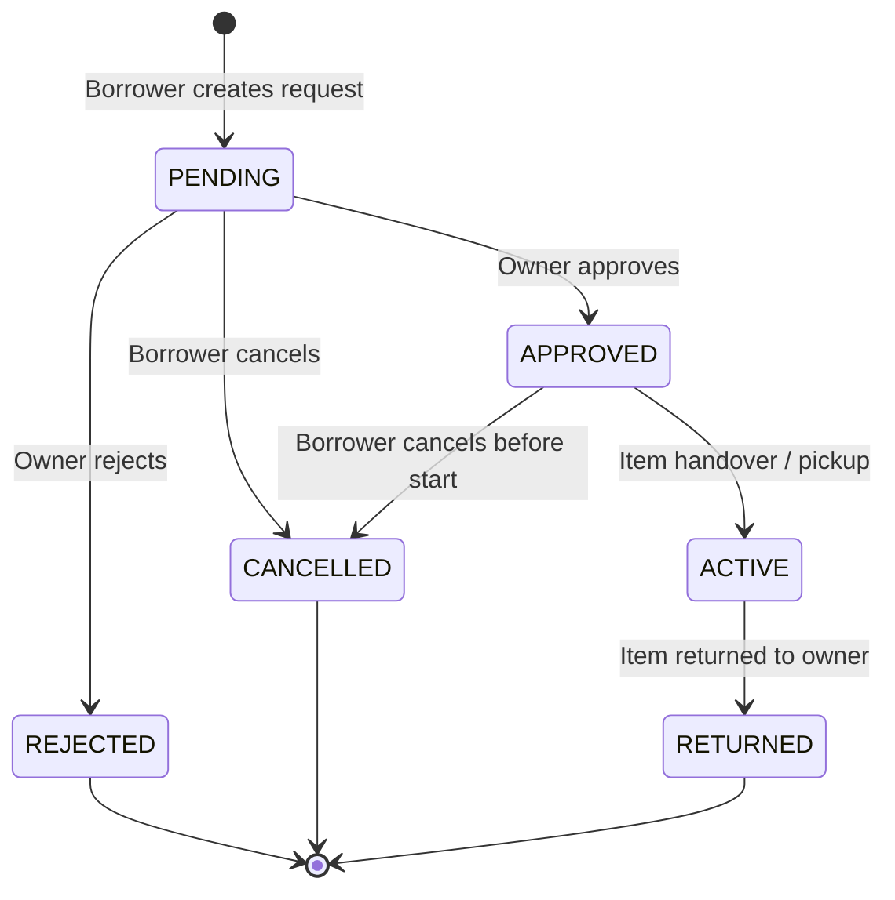

# BorrowBox API Documentation

> **Base URL:** `http://localhost:5000/api`  
> **Tagline:** *"Borrow More. Own Less."*  
> **Version:** 1.0.0

---

## 🔐 Authentication

BorrowBox uses **JWT (JSON Web Token)** authentication.
Protected endpoints require an `Authorization` header formatted as:

```http
Authorization: Bearer <jwt-token>
```

When authenticated, the user identity is securely derived on the server from verified JWT claims (`req.user.id`). User IDs provided in request bodies or query parameters are never trusted for ownership or authorization.

Passwords are never exposed in any API response.

---

## 📦 Response Format

### Success Response
```json
{
  "success": true,
  "message": "Optional descriptive message",
  "data": { ... },
  "pagination": {
    "total": 50,
    "page": 1,
    "limit": 20,
    "totalPages": 3
  }
}
```

### Error Response
```json
{
  "success": false,
  "error": {
    "message": "Human readable error description",
    "code": "ERROR_CODE",
    "details": [
      {
        "field": "startDate",
        "message": "startDate must precede endDate",
        "code": "custom"
      }
    ]
  }
}
```

### Common HTTP Status Codes
| Status | Meaning | Description |
|---|---|---|
| `200 OK` | Success | Request succeeded |
| `201 Created` | Created | Resource created successfully |
| `400 Bad Request` | Validation / Rule Error | Invalid inputs, bad state transition, self-borrow attempt |
| `401 Unauthorized` | Auth Required | Missing, invalid, or expired JWT |
| `403 Forbidden` | Access Denied | Not owner of item/request, cannot perform action |
| `404 Not Found` | Not Found | Requested entity does not exist |
| `409 Conflict` | Conflict | Overlapping booking period, unique constraint violation |
| `429 Too Many Requests` | Rate Limited | Exceeded request quota |
| `500 Server Error` | Internal Error | Unhandled server error |

---

## 1. Authentication Endpoints (`/api/auth`)

### 1.1 Demo Login (Pre-seeded Users)
Allows immediate login as one of the pre-seeded demo personas without entering passwords.

- **URL:** `POST /api/auth/demo-login`
- **Auth:** Public
- **Body:**
  ```json
  {
    "email": "alice@borrowbox.local"
  }
  ```
- **Response (200 OK):**
  ```json
  {
    "success": true,
    "message": "Logged in as demo user \"Alice Green\"",
    "data": {
      "user": {
        "id": "uuid-here",
        "name": "Alice Green",
        "email": "alice@borrowbox.local",
        "locality": "Oakwood Neighborhood",
        "createdAt": "2026-11-05T...",
        "updatedAt": "2026-11-05T..."
      },
      "token": "eyJhbGciOi..."
    }
  }
  ```

### 1.2 Standard Login
- **URL:** `POST /api/auth/login`
- **Auth:** Public
- **Body:**
  ```json
  {
    "email": "alice@borrowbox.local",
    "password": "BorrowBox123!"
  }
  ```
- **Response (200 OK):** Returns `{ user, token }`.

### 1.3 User Registration
- **URL:** `POST /api/auth/register`
- **Auth:** Public
- **Body:**
  ```json
  {
    "name": "Jane Doe",
    "email": "jane@example.com",
    "password": "SecurePassword123!",
    "locality": "Downtown District"
  }
  ```
- **Response (201 Created):** Returns `{ user, token }`.

### 1.4 List Demo Users
Returns the roster of seeded personas for interactive UI demo pickers.
- **URL:** `GET /api/auth/demo-users`
- **Auth:** Public
- **Response (200 OK):** Array of users with their item count.

### 1.5 Current User Profile
- **URL:** `GET /api/auth/me`
- **Auth:** Required (`Bearer`)
- **Response (200 OK):** Current user object with record counts (`items`, `borrowRequests`, `receivedRequests`, `notifications`).

---

## 2. Item Catalog Endpoints (`/api/items`)

### 2.1 List Items (Search & Filter)
- **URL:** `GET /api/items`
- **Auth:** Public
- **Query Parameters:**
  - `search` *(string)*: Case-insensitive search on title or description.
  - `category` *(enum)*: `TOOLS`, `ELECTRONICS`, `HOME_APPLIANCES`, `OUTDOORS_CAMPING`, `BOOKS_MEDIA`, `GARDENING`, `SPORTS_FITNESS`, `PARTY_GAMES`, `OTHER`.
  - `status` *(enum)*: `AVAILABLE` (default), `BORROWED`, `MAINTENANCE`, `UNAVAILABLE`.
  - `locality` *(string)*: Filter by owner's neighborhood/locality.
  - `page` *(number, default 1)*
  - `limit` *(number, default 20)*
- **Response (200 OK):**
  ```json
  {
    "success": true,
    "data": [
      {
        "id": "uuid",
        "title": "Bosch 18V Cordless Power Drill Set",
        "description": "Includes 2 batteries and bit set...",
        "category": "TOOLS",
        "imageUrl": "https://...",
        "status": "AVAILABLE",
        "ownerId": "uuid",
        "owner": {
          "id": "uuid",
          "name": "Alice Green",
          "locality": "Oakwood Neighborhood"
        }
      }
    ],
    "pagination": { "total": 8, "page": 1, "limit": 20, "totalPages": 1 }
  }
  ```

### 2.2 Get Item Details
- **URL:** `GET /api/items/:id`
- **Auth:** Public
- **Response (200 OK):** Full item details, owner profile, and upcoming approved/active booking intervals for calendar display.

### 2.3 Create Item Listing
- **URL:** `POST /api/items`
- **Auth:** Required (`Bearer`)
- **Body:**
  ```json
  {
    "title": "Kayak with Paddle and Life Vest",
    "description": "Single-person 10ft sit-on-top kayak. Very stable on calm water.",
    "category": "OUTDOORS_CAMPING",
    "imageUrl": "https://..."
  }
  ```
- **Response (201 Created):** Created item object with owner details.

### 2.4 Update Item Listing
- **URL:** `PATCH /api/items/:id`
- **Auth:** Required (`Bearer`, must be item owner)
- **Body (Partial):**
  ```json
  {
    "description": "Updated description with new details.",
    "status": "AVAILABLE"
  }
  ```
- **Response (200 OK):** Updated item.

### 2.5 Delete Item Listing
- **URL:** `DELETE /api/items/:id`
- **Auth:** Required (`Bearer`, must be item owner)
- **Rules:** Cannot delete an item that currently has `APPROVED` or `ACTIVE` borrow requests in progress.
- **Response (200 OK):** `{ "success": true, "message": "Item deleted successfully" }`

---

## 3. Borrowing Workflow Endpoints (`/api/borrow-requests`)

### State Transition Machine


### 3.1 Create Borrow Request
- **URL:** `POST /api/borrow-requests`
- **Auth:** Required (`Bearer`)
- **Body:**
  ```json
  {
    "itemId": "uuid",
    "startDate": "2026-11-10T09:00:00.000Z",
    "endDate": "2026-11-14T18:00:00.000Z"
  }
  ```
- **Business Rules Enforced:**
  1. **Self-Borrowing Prevention:** `item.ownerId !== borrowerId` (returns 400).
  2. **Chronology:** `startDate < endDate` and `startDate >= today` (returns 400).
  3. **Item Availability:** Item status must not be `MAINTENANCE` or `UNAVAILABLE` (returns 400).
  4. **Overlap Conflict Prevention:** No conflicting request with status in `APPROVED` or `ACTIVE` overlaps `[startDate, endDate]` (returns 409).
  5. **Duplicate Prevention:** Borrower cannot submit multiple pending requests for the same item across overlapping dates (returns 409).
- **Persistent Notification:** Automatically creates a `BORROW_REQUEST` notification for the item owner.
- **Response (201 Created):** New borrow request object.

### 3.2 List Outgoing Requests (Sent by Borrower)
- **URL:** `GET /api/borrow-requests/outgoing`
- **Auth:** Required (`Bearer`)
- **Query Parameters:** `status` *(optional)*, `page`, `limit`
- **Response (200 OK):** List of requests initiated by current user.

### 3.3 List Incoming Requests (Received by Owner)
- **URL:** `GET /api/borrow-requests/incoming`
- **Auth:** Required (`Bearer`)
- **Query Parameters:** `status` *(optional)*, `page`, `limit`
- **Response (200 OK):** List of requests received for items owned by current user.

### 3.4 Get Borrow Request Details
- **URL:** `GET /api/borrow-requests/:id`
- **Auth:** Required (`Bearer`, must be borrower or item owner)
- **Response (200 OK):** Request details including item, borrower, and owner info.

### 3.5 Approve Borrow Request
- **URL:** `POST /api/borrow-requests/:id/approve`
- **Auth:** Required (`Bearer`, must be item owner)
- **Concurrency & Transaction Safety:** Executed inside an interactive PostgreSQL transaction. Re-verifies at commit time that no overlapping request became approved or active.
- **State Transition:** `PENDING` -> `APPROVED`.
- **Persistent Notification:** Notifies borrower (`REQUEST_APPROVED`).
- **Response (200 OK):** Updated request.

### 3.6 Reject Borrow Request
- **URL:** `POST /api/borrow-requests/:id/reject`
- **Auth:** Required (`Bearer`, must be item owner)
- **State Transition:** `PENDING` -> `REJECTED`.
- **Persistent Notification:** Notifies borrower (`REQUEST_REJECTED`).
- **Response (200 OK):** Updated request.

### 3.7 Cancel Borrow Request
- **URL:** `POST /api/borrow-requests/:id/cancel`
- **Auth:** Required (`Bearer`, must be borrower)
- **Allowed From:** `PENDING` or `APPROVED`.
- **State Transition:** -> `CANCELLED`.
- **Persistent Notification:** Notifies owner (`REQUEST_CANCELLED`).
- **Response (200 OK):** Updated request.

### 3.8 Activate Borrowing (Item Handover)
- **URL:** `POST /api/borrow-requests/:id/activate`
- **Auth:** Required (`Bearer`, owner or borrower)
- **Precondition:** Request status must be `APPROVED`.
- **State Transitions (Atomic):**
  - Borrow request status: `APPROVED` -> `ACTIVE`
  - Item availability status: `AVAILABLE` -> `BORROWED`
- **Persistent Notification:** Notifies other party (`BORROW_ACTIVE`).
- **Response (200 OK):** Updated request.

### 3.9 Return Borrowed Item
- **URL:** `POST /api/borrow-requests/:id/return`
- **Auth:** Required (`Bearer`, owner or borrower)
- **Precondition:** Request status must be `ACTIVE`.
- **State Transitions (Atomic):**
  - Borrow request status: `ACTIVE` -> `RETURNED`
  - Item availability status: `BORROWED` -> `AVAILABLE`
- **Persistent Notification:** Notifies other party (`ITEM_RETURNED`).
- **Response (200 OK):** Updated request.

---

## 4. Notifications Endpoints (`/api/notifications`)

### 4.1 Get My Notifications
- **URL:** `GET /api/notifications`
- **Auth:** Required (`Bearer`)
- **Query Parameters:**
  - `unreadOnly` *(boolean)*: Filter for unread alerts.
  - `page`, `limit`
- **Response (200 OK):** List of notifications sorted latest first, plus `unreadCount`.

### 4.2 Get Unread Count
- **URL:** `GET /api/notifications/unread-count`
- **Auth:** Required (`Bearer`)
- **Response (200 OK):** `{ "success": true, "data": { "unreadCount": 3 } }`

### 4.3 Mark Single Notification as Read
- **URL:** `PATCH /api/notifications/:id/read`
- **Auth:** Required (`Bearer`, notification owner)
- **Response (200 OK):** Updated notification with `read: true`.

### 4.4 Mark All Notifications as Read
- **URL:** `PATCH /api/notifications/read-all`
- **Auth:** Required (`Bearer`)
- **Response (200 OK):** `{ "success": true, "message": "All notifications marked as read", "data": { "updatedCount": 5 } }`

---

## 5. Real-Time Socket.IO Events

BorrowBox mounts Socket.IO directly onto the Express HTTP server at `/socket.io/`.

### 5.1 Connection & Handshake Authentication
Clients must authenticate during the WebSocket handshake using the standard `auth` token:

```javascript
import { io } from 'socket.io-client'

const socket = io('http://localhost:5000', {
  auth: {
    token: '<jwt-token>'
  }
})
```

- **Server-Controlled Rooms:** Upon verified handshake, the server joins the socket exclusively to `user:${userId}`. Clients are strictly prohibited from subscribing to arbitrary user rooms.
- **Unauthorized Connections:** Connections without a token or with expired/invalid JWT signatures are immediately rejected with an `Authentication error`.

### 5.2 Server Emitted Events

| Event Name | Recipient | Trigger / Payload |
|---|---|---|
| `notification:new` | Specific User Room (`user:${userId}`) | Emitted when a new persistent notification is created (e.g. new borrow request, approval, rejection, activation, return). |
| `notification:read` | Specific User Room (`user:${userId}`) | Emitted when a user marks a notification as read. Payload: `{ notificationId }`. |
| `notification:read-all` | Specific User Room (`user:${userId}`) | Emitted when a user marks all notifications as read. |
| `borrow-request:created` | Item Owner Room (`user:${ownerId}`) | Emitted after a borrower creates a borrow request. Payload: `{ request }`. |
| `borrow-request:updated` | Both Borrower & Owner Rooms | Emitted after status transitions (`APPROVED`, `REJECTED`, `CANCELLED`, `ACTIVE`, `RETURNED`). Payload: `{ request }`. |
| `item:availability-updated` | Broadcast / Target User Rooms | Emitted when item availability flips (`AVAILABLE` ↔ `BORROWED`). Payload: `{ itemId, status }`. |

All Socket.IO events are emitted strictly **after** PostgreSQL database transactions commit successfully.

---

## 6. Redis Caching & Rate Limiting Layer

BorrowBox utilizes Redis (via `ioredis`) for high-throughput catalog queries and distributed rate limiting, paired with a resilient PostgreSQL fallback when Redis is offline.

### 6.1 Cache Architecture & Invalidation
- **Catalog List Queries:** Cached under `items:list:cat=<category>:q=<search>:loc=<locality>:st=<status>:p=<page>:lim=<limit>` with 300s (5-minute) TTL.
- **Item Details:** Cached under `items:detail:<itemId>` with 600s (10-minute) TTL.
- **Cache Invalidation:**
  - Creation of an item invalidates all `items:list:*` keys.
  - Updating an item invalidates both `items:detail:<itemId>` and all `items:list:*` keys.
  - Deleting an item invalidates both `items:detail:<itemId>` and all `items:list:*` keys.
  - Borrow status transitions (`ACTIVE`, `RETURNED`) update availability and immediately purge the item cache.

### 6.2 Graceful Degradation (PostgreSQL Fallback)
If Redis is not running or encounters a connection refusal, the cache service catches errors and logs:
```
⚠️ [Redis] Offline: Cannot connect to redis://localhost:6379. Application operating in PostgreSQL fallback mode.
```
All catalog and item endpoints seamlessly execute direct PostgreSQL queries through Prisma ORM with zero downtime.


